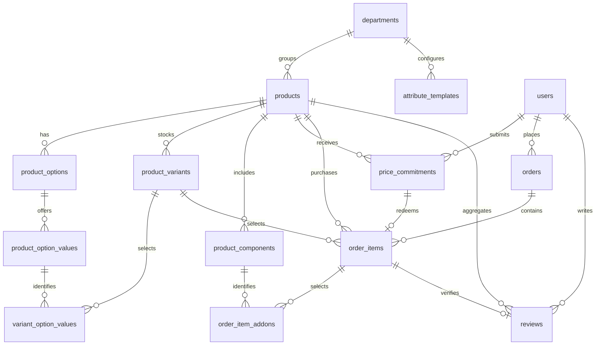

# Step 1: dynamic product schema and implementation review

Review date: 28 October 2026. The website is HTML/CSS/vanilla JavaScript on static hosting. PostgreSQL is a **proposed Phase 2 database**, not a connected production service. No migration was applied to a live database during this review.

## Database design

The design uses typed columns for common filters, JSONB for flexible specifications, and relational rows for inventory, offers and verified purchases.

| Entity | Data and relationships |
| --- | --- |
| `products` | Seller, department, brand, manufacturer, measured size and unit, age classifications, JSONB `specs`, fixed price, pricing mode, minimum/maximum offer price, cached rating average/count/breakdown |
| `product_options`, `product_option_values` | Named axes and values; colours have a name and hex code; measured sizes have a numeric value and unit |
| `product_variants`, `variant_option_values` | SKU, quantity, optional price/image per combination; every selected value belongs to the same product; exactly one value per axis |
| `product_components` | Included items or optional add-ons with a required nonnegative price |
| `price_commitments` | Buyer, product/variant, quantity, amount, seller-range snapshot, status, expiry and response time |
| `orders`, `order_items`, `order_item_addons` | Buyer identity, purchased variant, accepted commitment where applicable, and prices at purchase time |
| `reviews` | Product, buyer and delivered order item; 1–5 stars, title/body and timestamps; one review per buyer per product, linked to a delivered order item |
| `attribute_templates` | Category-specific fields and permitted units for the seller editor; server-side template data still needs importing from the catalogue |

Money uses `numeric(12,2)` in ZMW. Fixed and commit pricing remain separate; the buyer's offer is not an automatically accepted sale. Included components cannot acquire an add-on price. Add-on price snapshots are separate from the base `order_items.unit_price_zmw`; API mapping must not count them twice. The browser currently stores its combined unit price, so it needs an explicit adapter when backend orders are implemented.

## Migration order

Apply once, in order, using a migration runner or `psql -v ON_ERROR_STOP=1`:

1. `migrations/001_core.sql`
2. `migrations/002_attributes_reviews_commit_pricing.sql`
3. `migrations/003_integrity_hardening.sql`
4. `migrations/004_product_details.sql`
5. `migrations/005_units_and_photos.sql` (adds enum values outside a transaction first, then the rest in one transaction)
6. `migrations/006_orders_aftersales.sql`
7. `migrations/007_subcategories.sql`

Migration 004 adds optional item condition, required notes for non-new items, validated feature bullets and additional category-template fields. Extra variation axes use the existing custom-option relationships. See [the detailed product brief](../PRODUCT-FEATURES.md) for frontend field mapping and acceptance criteria.

Migration 005 adds units for storage (MB, GB, TB), battery capacity (mAh, Ah), power (W, kW), energy (Wh, kWh), voltage (V), plus cl, oz, lb and ft, and a `product_images` table for up to six extra photos per product. It also scales a buyer's offer range to a variation's own price, matching the browser.

Migration 006 adds what checkout and after-sales need: saved addresses, the delivery address copied onto each order, preferred delivery day and time, gift options, VAT (with a per-seller registration flag and TPIN), cancellations, returns with refunds, and complaints with a message thread, attachments and a per-seller count of upheld complaints.

Migration 007 adds department groups, subcategories and a subcategory on each product, which must belong to the product's own department. The rows come from `departmentGroups` and `departments` in js/catalogue.js.

Migration 003 corrects committed migration 002 without rewriting migration history. Existing invalid prices, mixed-product options or incomplete combinations abort the transaction. Existing offers are backfilled from the current seller range; if historical terms differ or the product no longer has a range, reconcile those records from authoritative order/offer history before migrating. Do not guess historical prices.

Save a variant matrix in one transaction. Supply `product_id` on option values and junction rows. `combo_key` is the selected option-value IDs sorted numerically and joined with `-`; deferred checks validate the completed graph at commit. The frontend's label-based key is only an in-memory identity and is not this database key.

Retain variants and option values referenced by historical orders. Mark discontinued variants inactive; do not delete their identities to reshape the catalogue. Changes to the set of axes after purchases require an explicit product-versioning policy in the backend.

The new rating trigger applies deltas to the product row instead of recounting an independently visible reviews snapshot. A buyer has one review per product, so repeat purchases can't skew the rating; after buying again they edit their existing review instead of adding one. Inserting, editing, hiding, restoring and deleting a review updates its cached average, count and five rating buckets atomically. API roles must prohibit clients from writing cached fields directly. Native multi-session concurrency testing remains required before deployment.

## Compliance review

| Requested step | Finding |
| --- | --- |
| 1. Schema and migrations | Present, hardened in 003, and executed with regression fixtures in PostgreSQL 18.6 through PGlite 0.5.12. Native PostgreSQL 15 compatibility and multi-session races were not executed here. |
| 2. Backend API endpoints | **Not implemented.** `ZSProduct.listings(...)` is an in-browser localStorage helper, not HTTP endpoints, authentication, authorization or shared persistence. |
| 3. Seller dashboard | Browser prototype supports optional category-suggested fields, colour/size plus two custom choice axes, per-variant SKU/stock/pricing, condition notes, features, age checkboxes, components/add-ons and the offer toggle. Records remain local. |
| 4. Buyer product page | Browser prototype includes swatches, sizes, add-ons, offer controls, rating distribution and a scrollable review list. Prices and cart choices are local. Verified-purchase enforcement and cached review aggregates are only in the proposed database. |

Corrected in this review:

- SQL NULL loopholes in conditional pricing checks and non-finite prices.
- Cross-product variant references, incomplete axis selections and manually inconsistent combination keys.
- Offers edited after creation or redeemed before acceptance, by another buyer, at a different price/quantity, or more than once.
- Included components selected as priced optional add-ons, or wrong add-on prices.
- Race-prone review recounts and missing cache consistency checks.
- Frontend whole-Kwacha rounding, malformed stock counts, invalid measured option sizes, colliding automatic SKU prefixes and loss of variation images during edits.
- Offer controls that became stale when switching to a differently priced variation, missing review headlines and local cart quantities exceeding known variant stock.
- Variant-photo changes targeting the fallback icon instead of the actual product photo, including restoring the base photo and respecting data saver.

## What remains before production

Implement authenticated HTTP endpoints and a real database connection. Resolve the future authentication identity mapping (the proposal uses bigint users; Supabase Auth uses a separate identity). Enforce seller ownership on mutations and buyer ownership on orders, offers and reviews. The database constraints validate data relationships; they do not identify the authenticated caller.

Recompute all prices, discounts and add-ons on the server. Reserve/decrement stock in the same transaction as checkout with row locks and idempotency keys; browser checks cannot prevent concurrent overselling. Expire stale pending offers. Protect historical order rows and accepted terms through narrowly granted server roles, and make order/add-on snapshots immutable after confirmation.

The review form still allows explicitly unverified browser-only feedback and stores it per device/product, not per authenticated purchase. It therefore does **not** yet fulfil the verified-purchase review workflow. Wire it to the reviews endpoint before calling that workflow complete. Browser filters now cover colour, age, equivalent measured sizes, manufacturer, brand, condition, price, rating and offer eligibility. Server equivalents remain to be implemented.

Suggested next-step routes (design only, not implemented):

- `POST /api/seller/products`, `PATCH /api/seller/products/:id`, `GET /api/products/:id`
- `GET /api/departments/:id/attribute-template`, `GET /api/products` with validated filters
- `POST /api/products/:id/commitments`, `PATCH /api/seller/commitments/:id`
- `GET /api/products/:id/reviews`, `POST /api/order-items/:id/reviews`, `PATCH /api/reviews/:id`

## Reproducible checks

Run `node --test tests/*.test.cjs` for the JavaScript tests. For SQL, apply all seven migrations in order to an isolated database, then run each file in `db/tests/` with `psql -v ON_ERROR_STOP=1 -f <file>`. The SQL tests roll back their fixtures. `integrity.sql` and `product_details.sql` cover invalid data, purchase links, review aggregates, conditions, features and custom options. `aftersales_categories.sql` covers migrations 005–007: the new units, extra photos, offer ranges scaled to a variant's price, saved addresses, order snapshots, cancellations, returns, complaints and subcategories.

Latest check (29 October 2026): all seven migrations applied cleanly and all three SQL test files passed in PostgreSQL 18.6 through PGlite 0.5.13, and all 22 JavaScript tests passed under Node.js 26. Deliberately broken copies of the new SQL tests failed as expected, so they are not passing trivially. PostgreSQL itself isn't installed on the development machine; PGlite was installed temporarily for the run and removed afterwards. These checks do not replace a native multi-connection concurrency test.

References: [PostgreSQL CHECK semantics](https://www.postgresql.org/docs/16/ddl-constraints.html), [transaction isolation](https://www.postgresql.org/docs/16/transaction-iso.html), [PGlite test engine](https://pglite.dev/docs/).
